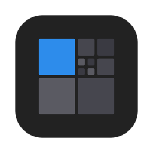

<p align="center"></p>

<h1 align="center">Spacious</h1>

<p align="center"><b>See what's taking up your disk.</b> A fast, live treemap for macOS.</p>

<p align="center">
  <a href="https://github.com/jaerasgon/spacious/releases/latest"><b>Download</b></a>
  ·
  <a href="https://ko-fi.com/jaerasgon"></a>
</p>

Spacious scans a folder (or your whole disk) and draws it as a map of rectangles: the
bigger the rectangle, the more space it takes. Click a folder to open it in place, and
keep clicking until you find what's filling your drive. It's in the spirit of SpaceSniffer,
made for the Mac.

## What it does

- **Scans fast.** Folders are read in parallel: about 1.6 million files in under 8 seconds
  on an M-series Mac, with no limit on how many files a folder holds.
- **Counts what's really used.** Sizes are space on disk, so sparse files (like Docker
  images) don't look bigger than they are, and hard-linked files count once.
- **Opens folders in place.** You start with big rectangles. Click a folder to see inside
  it, double-click to zoom in, press ⌫ to go back up.
- **Colours by file type.** Video, images, code, archives and more each have a colour, and
  folders take the colour of whatever fills most of them. Click a type in the legend to
  dim it.
- **Updates live.** Delete, move or add files in Finder and the map changes within a
  second. No rescan needed.
- **List view and search.** Switch to a sortable list, or search every name in the folder
  you're in.
- **Right-click anything** to reveal it in Finder, open it, open a Terminal there, copy its
  path, or see its largest files.
- **Dark, Darker and Light themes.**

## Download

Get the latest **Spacious-…-macos-universal.zip** from
[Releases](https://github.com/jaerasgon/spacious/releases/latest), unzip it, and drag
**Spacious** to Applications. It runs on Apple silicon and Intel Macs with macOS 11 or
later, and it's signed and notarized by Apple.

To see folders macOS protects (Mail, Messages, Safari and others), give Spacious **Full
Disk Access** in System Settings ▸ Privacy & Security. Spacious tells you when some folders
couldn't be read, and clicking that note opens the right settings page.

## Shortcuts

| Key | Action |
|---|---|
| ⌘O | Choose a folder to scan |
| ⌘R | Rescan |
| ⌘1 / ⌘2 | Treemap / List |
| ⌘K | Search names |
| Click | Open a folder in place |
| Double-click, ↩ | Zoom into a folder |
| ⌫, ⌘↑ | Up one level |
| Esc | Back to the top |
| ⌘I | Properties of the selection |

## Build from source

You need Rust (1.88 or later) and Xcode's command line tools.

```bash
git clone https://github.com/jaerasgon/spacious.git
cd spacious
cargo run --release -- ~/Downloads
```

`./bundle.sh` builds `dist/Spacious.app` as a universal app. Set `SIGN_ID` to your
Developer ID to sign it, and `NOTARY_PROFILE` to notarize it; the script explains both.
`cargo test` runs the tests, including one that checks live updates against real macOS
file events.

## Support Spacious

Spacious is free and will stay free. If it's useful to you and you'd like to help me keep
building it, you can leave a tip on [Ko-fi](https://ko-fi.com/jaerasgon). Feedback and bug
reports help just as much.

<a href="https://ko-fi.com/jaerasgon"></a>

## Licence

[MIT](LICENSE). Inter and JetBrains Mono are included under the SIL Open Font License
([Inter](assets/fonts/OFL-Inter.txt), [JetBrains Mono](assets/fonts/OFL-JetBrainsMono.txt)).
